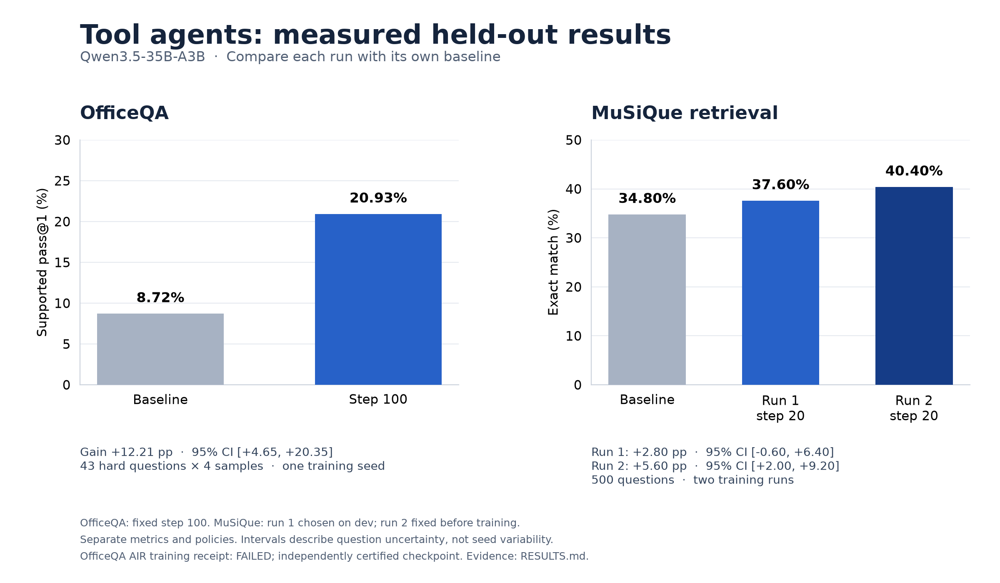

# Presenting the use cases

Lead with a concrete task, show what the agent does, then show the held-out
comparison. The story is that the same training engine supports retrieval and
document research, with a reward and evaluation suited to each task.

This five-part outline takes about five minutes. Use the committed figures;
it can be presented offline without launching a training job.

| Part | Visual or source | Point to explain |
|---|---|---|
| 1. The task | [OfficeQA workflow](../usecases/officeqa/README.md#what-the-agent-does) | Find the right table, calculate the answer, cite the observations used |
| 2. One answer before/after | UID0025 below | A correct value can still have an invalid evidence path |
| 3. Held-out results | [Comparison figure](../results/heldout-summary.png) | Show each task's gain against its own baseline, with paired uncertainty |
| 4. Reproduce it | [Run commands](../usecases/officeqa/README.md#run-a-new-experiment) | Prepare a named run, inspect its plan, run it, inspect receipts |
| 5. Reuse it | [Document-research blueprint](document-research.md) | Change the corpus and question adapter while preserving evidence accounting |

## A concrete before/after example

OfficeQA question **UID0025** asks for the difference in public-works spending
between 1934 and 1946. Sample 1 answered **142** both before and after training.
The baseline cited document descriptions and “compute result”, which were
invalid observation references. The trained sample cited delivered `obs_5`,
`obs_13` and `obs_16`; the judge accepted the path.

| Same question and sample | Final value | References | Supported reward |
|---|---|---|---:|
| Baseline | 142 | Document descriptions; “compute result” | 0 |
| Step 100 | 142 | Delivered `obs_5`, `obs_13`, `obs_16` | 1 |

This is an abridged description of recorded traces. It was selected after the
fixed evaluation for illustration. The [behavior audit](../results/officeqa/2026-10-11-final-behavior.json)
contains all four samples for this case, the improving Zipf-exponent case
UID0042, and the regressing OCS-rents case UID0068.

## The results visual



OfficeQA trained on 203 questions for 100 updates and evaluated 43 held-out hard
questions with four samples each. Its **8.72% → 20.93%** supported pass@1 has a
**+12.21 pp** gain and **[+4.65, +20.35] pp** paired 95% interval. Both evaluations
completed without infrastructure errors. Training's AIR service status remains
**FAILED**, despite an independently certified step-100 checkpoint and clean node
exits; the [report](../results/officeqa/2026-10-11-final-report.md) explains the
completion review and unresolved platform cause.

MuSiQue's held-out exact match was **34.8%** for the baseline, **37.6%** for run 1
and **40.4%** for run 2. Run 1's interval includes zero; run 2's predetermined
step-20 checkpoint gained **+5.6 pp [+2.0, +9.2]**, with paired p = 0.004.
The earlier **54% → 58.5%** development-set score selected a checkpoint and
should be labeled as development evidence when shown. [RESULTS](../RESULTS.md)
contains both protocols and every comparison.

OfficeQA uses the tested PyTorch 2.13 / verl development snapshot; MuSiQue's
measurements used the earlier stack. Each score describes its own evaluation
policy over a shared corpus. OfficeQA has one training seed and MuSiQue two;
the intervals quantify question uncertainty. OfficeQA also used more delivered
observations after training, so this presentation makes no efficiency-gain claim.
Math is an available judge-based recipe without a published learning result.

## A practical demo

Start from the [OfficeQA guide](../usecases/officeqa/README.md). Show its code
map, a prepared `plan.json`, the receipts from `officeqa-final-status`, and
the final `comparison.json`. For the completed experiment, display the
committed report and plots. To show the control flow locally:

```bash
make help
.venv/bin/python usecases/officeqa/final_run.py --help
```

The [PNG](../results/heldout-summary.png) works in slides, while the
[SVG](../results/heldout-summary.svg) can be scaled for export. Rebuild the
figure from the same committed evidence with:

```bash
uv run --no-project --with matplotlib==3.11.2 python scripts/summarize_results.py --plot
python3 scripts/summarize_results.py --check
```

The summary script reads evidence files and does not launch jobs or change
their measurements.
