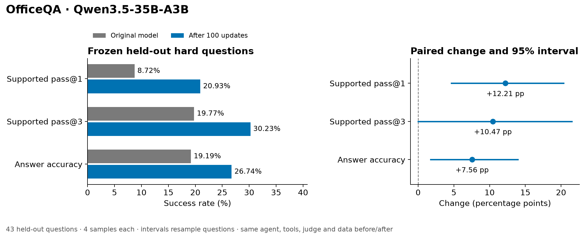
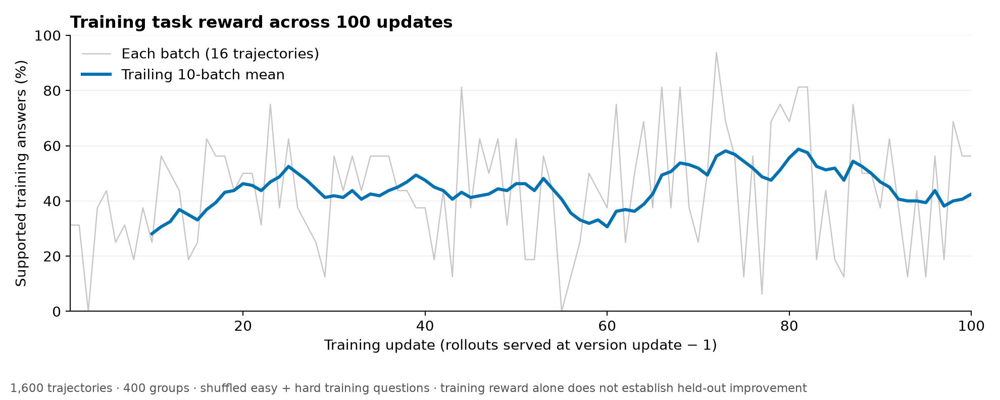

# Final OfficeQA results

Supported held-out pass@1 improved, and its paired 95% confidence interval excludes zero. The original model achieved 8.72%; the fixed step-100 model achieved 20.93%, a change of +12.21 percentage points.

The experiment matched Miles' official split: **113 easy + 90 hard = 203 training questions**, with **43 hard questions held out**. Training ran for **100 updates**, **400 groups** and **1,600 trajectories**. Both evaluations scored all **236 predetermined episodes**, including four samples for each held-out question and each of 16 fixed training probes. No held-out result selected training questions, the run length or the checkpoint.

Training's AIR job ended with a generic `CLIENT_ERROR / RUN_EXECUTION_ERROR` after both node commands exited 0. The original training certificate verifies step 100, all 14 weight shards, raw/final exits 0, no abort and no hard-error matches. Weight verification checks shard headers, tensor completeness and sampled contents; it is not a full hash of the 70 GB weights. A separate audit verified every training trajectory before the controller resumed artifact export and evaluation. The AIR status remains **FAILED** in the receipts; the platform cause remains unresolved. The evaluation uses the independently certified model.

| Held-out metric | Original | Step 100 | Change | Paired 95% interval |
|---|---:|---:|---:|---:|
| Supported pass@1 | 8.72% | 20.93% | +12.21 pp | [+4.65, +20.35] pp |
| Supported pass@3 | 19.77% | 30.23% | +10.47 pp | [+0.00, +21.51] pp |
| Answer accuracy | 19.19% | 26.74% | +7.56 pp | [+1.74, +13.95] pp |

Supported successes changed from **15/172** to **36/172**. For the primary metric, 11 questions improved, 2 regressed and 30 were unchanged. Intervals resample the 43 questions, keeping each question's four correlated samples together. These are new questions over the same Treasury Bulletin corpus.

The primary supported pass@1 criterion passed. The pass@3 interval includes zero, so its observed increase remains uncertain.

The 16 training probes changed from 29.69% to 50.00% supported pass@1. Across training, 700 of 1,600 trajectories earned supported rewards, and 195 of 400 groups had mixed rewards. The traces cover 203 distinct permitted training questions. Training reward alone does not establish held-out improvement.

Training took about 9.5 hours; baseline and final evaluation took 58.5 and 60.8 minutes respectively.

| Held-out behavior | Original | Step 100 |
|---|---:|---:|
| Final-report submission rate | 83.72% | 84.88% |
| Correct answers with invalid references | 13 | 0 |
| Correct answers with valid references but unsupported paths | 5 | 10 |
| Episodes without a final report | 28 | 26 |
| Mean delivered observations | 28.78 | 33.94 |
| Mean generated tokens | 11499 | 11096 |

The largest supported-success increase was **UID0042**, asking for the Zipf exponent of 2020 state unemployment-insurance tax receipts. The baseline had 0/4 supported samples; the final model had 3/4. Both models could produce the correct value, **1.172**. An illustrative baseline report cited document names and “Python calculation”; the final report cited delivered `obs_7` and `obs_18`, and the judge accepted its evidence path.

On **UID0025**, the public-works spending difference between 1934 and 1946, sample 1 returned **142** before and after training. The baseline cited document descriptions and “compute result”, which were invalid observation references. The final sample cited delivered `obs_5`, `obs_13` and `obs_16` and earned a supported reward. The question improved from 0/4 to 1/4 supported samples.

The largest decrease was **UID0068**, asking for the lowest absolute OCS rents and royalties in 2016: 1/4 supported samples before training and 0/4 afterward. Three final samples returned the correct value **56** with valid references, but their paths were judged unsupported. Across held-out evaluation, ten correct final answers still had unsupported paths and 26 episodes ended without a final report. The model also delivered more observations on average, so the gain does not establish lower tool-use cost.

These cases were selected after the fixed evaluation for illustration. All 43 questions determine the metrics and intervals. The [raw evaluation audit and cases](2026-10-11-final-behavior.json) include all four samples per case, tool outcomes and checksums for both complete 236-episode raw files. Every raw episode matched its aggregate score and official question text; observation IDs and delivery chronology passed verification.

The actor is **Qwen3.5-35B-A3B**, initialized from the original weights. The image is the previously tested **v13-verl010-officeqa-bm25**: **PyTorch 2.13.0**, **verl 0.10.0.dev0** at `8718ca30`, **vLLM 0.30.0**, **Transformers 5.16.1**, **CUDA 13.0**. Its digest is `sha256:fb2f959ad6c423040fe725e4ce8cb0babea7ba1be5ed3e808de8084710f4648d`. Training used 16 H100s; each evaluation used eight. The hosted `system.ai.glm-5-3-flash` judge used no GPUs from these jobs.

Training and evaluation share the continuous-token OfficeQA controller, search/read/grep/list tools, sandboxed arithmetic, and `submit_report(answer, path)`. A reward requires both a correct answer and a supported path citing observations actually delivered to the actor. The policy remained at 128 assistant turns with one tool call per turn, 4,096 generated tokens per turn, 8,000 tool-result characters and a 98,304-token context (96,256 response tokens). The learning rate was configured at `1e-6`, with seed 42. In-training held-out validation was disabled.

This is one seeded run on 43 held-out hard questions over the shared corpus. The intervals quantify the paired question results under this protocol; they do not measure variability across training seeds or other document collections.

All stages used `df1` and frozen worker source `9a543239eb40e7e60c8a326cb4afde92b7a5b4bc`. The independent audit verified 1,600 unique raw training episodes, 400 complete four-sample groups, permitted training UIDs, zero infrastructure rewards, all evaluation samples, matching before/after policy and data, and the certified step-100 model identity `6d6eb3c6134cc516`. The metric changes and confidence intervals were independently recomputed.

The 11 controller tests and `make lint` passed. The controller change permits continuation after an AIR training failure only with an explicit SHA256-pinned review of the clean final certificate, complete training audit, both node exits and generic platform error. It preserves the failed AIR receipt; no worker, scorer, image, data or evaluation-policy change was made during recovery.

- baseline: [679618243056695](https://dbc-559ffd80-2bfc.cloud.databricks.com/jobs/runs/679618243056695?o=7395834863327820) (SUCCESS, 58.5 minutes)
- eval: [623602877521600](https://dbc-559ffd80-2bfc.cloud.databricks.com/jobs/runs/623602877521600?o=7395834863327820) (SUCCESS, 60.8 minutes)
- prep: [252353129579893](https://dbc-559ffd80-2bfc.cloud.databricks.com/jobs/runs/252353129579893?o=7395834863327820) (SUCCESS, 3.1 minutes)
- train: [612185663086483](https://dbc-559ffd80-2bfc.cloud.databricks.com/jobs/runs/612185663086483?o=7395834863327820) (FAILED, 568.1 minutes)
- train-export: [860784267659986](https://dbc-559ffd80-2bfc.cloud.databricks.com/jobs/runs/860784267659986?o=7395834863327820) (SUCCESS, 2.5 minutes)

The [baseline](2026-10-11-final-baseline.json), [final evaluation](2026-10-11-final-eval.json), [paired comparison](2026-10-11-final-comparison.json) and [independent audit](2026-10-11-final-audit.json) contain the receipts and per-question measurements. Full trajectories remain under `/Volumes/main/mshtelma/verl/eval/officeqa-final/`; the final checkpoint is `/Volumes/main/mshtelma/verl/ckpt/qwen3_5-35b-officeqa-final/officeqa-final-20261011-v1-train/global_step_100`. The branch is `experiment/verl010-officeqa-final`.
