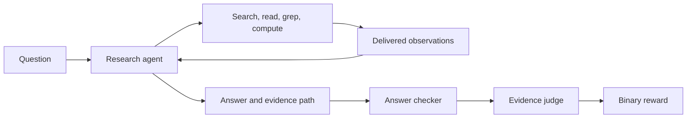

# OfficeQA: research answers with evidence

Train an agent to find figures in Treasury Bulletins, calculate with Python,
and submit an answer with a verifiable evidence path. The final 100-update run
improved supported pass@1 on 43 held-out hard questions from **8.72% to 20.93%**
(+12.21 percentage points; paired 95% interval **+4.65 to +20.35**).

[Results and traces](../../results/officeqa/2026-10-11-final-report.md) ·
[Experiment protocol](FINAL_RUN.md) · [Presentation guide](../../docs/showcase.md) ·
[Adapt this use case](../../docs/document-research.md)

## What the agent does

The corpus has 697 Treasury Bulletins and 131,113 table-aware BM25 chunks.
The agent can search, grep, read and list documents, and use isolated Python
for arithmetic. It finishes with `submit_report(answer, path)`.



A reward of one requires both a correct answer and a supported path. The
runtime assigns observation IDs after clipping tool results and records which
observations actually reached the actor. The judge checks citations against
those delivered observations. Wrong answers skip the judge; service or scorer
failures stop the run. Training and evaluation share the agent loop and scorer.

## The measured recipe

| Setting | Value |
|---|---|
| Actor | Qwen3.5-35B-A3B |
| Training questions | 113 easy + 90 hard = 203 |
| Held-out questions | 43 hard; no training or checkpoint selection |
| Training | 100 updates, 400 groups, four trajectories per group; seed 42 |
| Evaluation | Four samples per held-out question, plus 16 fixed training probes |
| Agent budget | 128 turns, 98,304-token context, one tool call per turn |
| Training compute | 16 H100s: eight trainer/reference, eight rollout |
| Each evaluation | Eight H100s |
| Judge | Hosted `system.ai.glm-5-3-flash`; no GPUs from the training allocation |
| Tested image | v13; PyTorch 2.13.0, verl 0.10.0.dev0 at `8718ca30`, vLLM 0.30.0 |

Both evaluations scored 236/236 episodes with zero infrastructure errors.
Training took about 9.5 hours. Its AIR receipt is **FAILED**, although both node
commands exited zero and the complete step-100 checkpoint passed an independent
completion review. The [report](../../results/officeqa/2026-10-11-final-report.md)
preserves this unresolved platform discrepancy and the limits of the weight
verification. This is one training seed over a shared corpus; the confidence
interval describes paired question results.

## Run a new experiment

First follow [workspace setup](../../docs/setup.md). Set `config.env`, run
`make retarget`, and commit the changes: preparation archives a clean Git
revision. Retargeting updates image and Volume references. Set `JUDGE_BASE_URL`
and `JUDGE_MODEL` in the four `*_final.yaml` jobs for your workspace; these
service settings are explicit YAML values.

The raw inputs must already be staged under `OQ_SOURCE_DIR`:
`officeqa_full.csv` and `treasury_bulletins_clean.zip`. The actor and judge
tokenizer must be staged at the model paths in the YAML. Use the model-staging
instructions in [running-jobs](../../docs/running-jobs.md); the hosted judge
needs its tokenizer locally, not its weights. Use your own registered image
if you cannot access the example image, and record it with `make push`.

From the repository root:

```bash
make dev-env
make check AIR_PROFILE=df1

# Choose a fresh name. This freezes source and validates jobs without launching GPUs.
make officeqa-final-prepare EXPERIMENT=officeqa-my-run AIR_PROFILE=df1

# Inspect .cache/officeqa-final/officeqa-my-run/plan.json, then submit all stages.
make officeqa-final-run EXPERIMENT=officeqa-my-run BUDGET_OK=1

# In another terminal; reads the saved receipts without a remote call.
make officeqa-final-status EXPERIMENT=officeqa-my-run
```

The profile is frozen in the plan; subsequent commands use it. The pipeline
runs qualification/preparation → baseline → training → artifact export → final
evaluation. Its timeout bound is about **641 GPU-hours**, while measured
training plus evaluations used about **168 H100-hours**. A10 preparation/export
and hosted judge tokens are additional. Check the generated plan for the
bound applicable to your job files.

Keep the controller in a persistent terminal. Repeating `officeqa-final-run`
uses the saved receipts and idempotency keys to resume monitoring. It does not
restart a failed training job. A failure stops progression; the narrowly
scoped completion-review mechanism is documented in [FINAL_RUN.md](FINAL_RUN.md).

The run directory contains `plan.json`, `state.json`, frozen source, logs,
receipts and the final `comparison.json`. Remote data snapshots and checkpoint
directories use the experiment name. To place local evidence elsewhere, pass
the same `OFFICEQA_RUN_DIR=/absolute/path` to all three Make targets.

## Find the code

| Concern | Start here |
|---|---|
| Launch, resume and receipts | [final_run.py](final_run.py), [air/](air/) |
| Prompt, questions and official split | [task.py](task.py), [prep_data.py](prep_data.py) |
| Continuous-token training/evaluation loop | [protocol.py](protocol.py), [agent_loop.py](agent_loop.py) |
| Tool API and terminal report | [tool.py](tool.py), [tools.json](tools.json) |
| Retrieval and table chunks | [corpus.py](corpus.py), [chunker.py](chunker.py) |
| Isolated arithmetic | [sandbox.py](sandbox.py) |
| Answer and evidence scoring | [reward.py](reward.py), [answer_check.py](answer_check.py), [path_report.py](path_report.py) |
| Held-out samples and paired intervals | [eval.py](eval.py), [metrics.py](metrics.py) |
| Regression checks | [tests/](tests/) |

[SOURCE.json](SOURCE.json) records provenance and hashes for code ported from
Miles. Keep its answer-checking, chunking, prompt and evidence semantics
traceable when adapting the task. The launch/controller code is separate from
the worker policy, and the measured worker revision remains recorded in the
results. The older `officeqa-*` Make targets exercise a smaller integration
pilot; see [PILOT.md](PILOT.md) and [pilot results](RESULTS.md).
