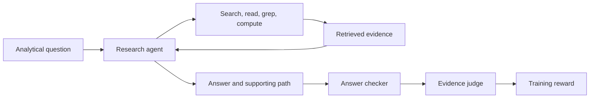

# Training an OfficeQA research agent

Train an agent to answer analytical questions over a large document archive.
It searches Treasury Bulletins, reads tables, calculates with Python, and
returns an answer with its supporting evidence. In our 100-update experiment,
supported pass@1 on 43 held-out hard questions rose from **8.72% to 20.93%**
(+12.21 percentage points; paired 95% interval **+4.65 to +20.35**).

[Results and examples](../../results/officeqa/2026-10-11-final-report.md) ·
[Experiment protocol](FINAL_RUN.md) · [Presentation guide](../../docs/showcase.md) ·
[OfficeQA background and next experiment](../../docs/document-research.md)

## What the agent does

[OfficeQA](https://github.com/databricks/officeqa) was created to test grounded
reasoning over documents that resemble complex enterprise archives. Its
Treasury Bulletin corpus spans 1939–2025 and contains dense tables, prose,
charts and revisions to previously published figures. Questions require finding
the right evidence and applying the right analysis, including statistical
calculations and checks on units and reporting periods.

This recipe starts from parsed text and indexes 697 bulletins as 131,113
BM25 chunks that retain table context. The agent can search, grep, read and list
documents, use isolated Python for calculations, and finish with
`submit_report(answer, path)`.



The reward requires both a correct answer and a supported path. Each tool
response gets an observation ID, and the runtime records the text delivered to
the actor. The judge checks the submitted path against those observations.
Wrong answers receive zero without a judge call; a scorer or service failure
stops the run. Training and evaluation use the same agent loop and scorer.

This evidence requirement is an addition to OfficeQA's answer-correctness
metric. Our answer checker differs from the creators' scorer. The agent also uses a
different prompt and tool budget from the paper, with no web-search or image
tool. The reported scores therefore describe this experiment's policy and
question subset.

## The measured recipe

| Setting | Value |
|---|---|
| Actor | Qwen3.5-35B-A3B |
| Dataset | OfficeQA Full: 113 easy + 133 hard questions |
| Training questions | 113 easy + 90 hard = 203 |
| Held-out questions | Remaining 43 hard; excluded from training and checkpoint selection |
| Training | 100 updates, four trajectories per group; seed 42 |
| Evaluation | Four samples per held-out question, plus 16 training probes |
| Agent budget | 128 turns, 98,304-token context, one tool call per turn |
| Training compute | 16 H100s: eight trainer/reference, eight rollout |
| Each evaluation | Eight H100s |
| Judge | Hosted GLM-5.3-Flash; no additional judge GPUs |
| Runtime | PyTorch 2.13.0, verl 0.10.0.dev0, vLLM 0.30.0 |

The split comes from the [Miles OfficeQA example](https://github.com/mshtelma/miles/tree/main/examples/glm5_3_flash/officeqa).
The creators do not define a training split. Their headline
**OfficeQA Pro** benchmark contains all 133 hard questions; Full adds the easy
questions for system development. See the [paper](https://arxiv.org/abs/2603.08655)
for the benchmark design and evaluation settings.

Training took about 9.5 hours. The result comes from one training seed over a
shared corpus. AIR reported a training failure; the
[report](../../results/officeqa/2026-10-11-final-report.md) explains the manual
completion review required before evaluation could proceed.

## Run a new experiment

Follow [workspace setup](../../docs/setup.md) first. Set your profile, image and
Volume in `config.env`, then run `make retarget`.

The final jobs use `JUDGE_PROVIDER=databricks` and
`JUDGE_MODEL=system.ai.glm-5-3-flash`. The client derives the gateway URL from
the authenticated workspace and uses AIR's ambient Databricks SDK credentials.
The job identity needs `USE CATALOG` on `system`, `USE SCHEMA` on `system.ai`
and `EXECUTE` on that model service, along with workspace access. Confirm that
the service is available in your region. Changing the judge changes the
training reward and limits comparison with the published result.

Obtain access to the creators' gated
[OfficeQA dataset](https://huggingface.co/datasets/databricks/officeqa).
Authenticate with Hugging Face, then download the pinned parsed JSONs,
transformed text and question CSV and build the corpus and retrieval chunks:

```bash
make dev-env
.venv/bin/hf auth login
make officeqa-corpus
```

Document reading and grep use a lossless table renderer that preserves commas
and empty cells. The measured BM25 index uses the creators' published transformed
text, whose table formatting can differ. The builder preserves both inputs and
reproduces all 697 document texts and 131,113 retrieval chunks. The dataset
revision, CSV hash, corpus content hash and chunk hash are recorded in
[DATA.lock.json](DATA.lock.json). The preparation job checks them and stops
if the staged data differs. ZIP metadata may differ without changing the text.

Upload the three files to the retargeted job's `OQ_SOURCE_DIR`:

```bash
databricks fs cp .cache/officeqa-source/officeqa_full.csv \
  dbfs:/Volumes/<catalog>/<schema>/<volume>/data/officeqa/officeqa_full.csv \
  --profile <profile>
databricks fs cp .cache/officeqa-source/treasury_bulletins_clean.zip \
  dbfs:/Volumes/<catalog>/<schema>/<volume>/data/officeqa/treasury_bulletins_clean.zip \
  --profile <profile>
databricks fs cp .cache/officeqa-source/chunks.jsonl \
  dbfs:/Volumes/<catalog>/<schema>/<volume>/data/officeqa/chunks.jsonl \
  --profile <profile>
```

Stage the actor with `make stage`. The hosted judge needs tokenizer and config
files at `JUDGE_TOKENIZER_PATH`. For the measured Flash configuration, download
them using the model revision already pinned in the staging YAML:

```bash
uv run --no-project --with huggingface_hub --with PyYAML python - <<'PY'
from pathlib import Path
from huggingface_hub import snapshot_download
import yaml

model = yaml.safe_load(Path("usecases/math/air/2_stage_judge.yaml").read_text())["env_variables"]
snapshot_download(model["MODEL_ID"], revision=model["MODEL_REVISION"],
                  allow_patterns=["*.json", "*.txt", "*.model", "*.jinja", "*.py"],
                  local_dir=".cache/officeqa-judge-tokenizer")
PY
databricks fs cp .cache/officeqa-judge-tokenizer \
  dbfs:/Volumes/<catalog>/<schema>/<volume>/models/GLM-5.3-Flash \
  --recursive --profile <profile>
```

Use the tokenizer that matches your hosted judge if you choose another model.
The [running guide](../../docs/running-jobs.md) covers the other use cases' model staging.

Build and register your own image; the example image is in a private registry.
[Build instructions](../../docs/build-linux.md) describe the dependency and
image checks.
Commit the configuration and image lock before preparing an experiment.
Preparation requires a clean Git checkout so that each job receives the same code.

From the repository root:

```bash
make dev-env
make check

# Choose a new experiment name and validate the complete pipeline.
make officeqa-final-prepare EXPERIMENT=<unique-name>

# Inspect .cache/officeqa-final/<unique-name>/plan.json, then submit.
make officeqa-final-run EXPERIMENT=<unique-name> BUDGET_OK=1

# Show the saved run state in another terminal.
make officeqa-final-status EXPERIMENT=<unique-name>
```

Replace `<unique-name>` with an unused experiment name in your workspace.
The pipeline runs preparation → baseline → training → artifact export → final
evaluation. Preparation saves the selected profile, code, image and paths;
subsequent commands use that plan. Its configured timeout bound is about
**641 GPU-hours**. Measured training and evaluations used about **168
H100-hours**, with A10 preparation, artifact export and hosted judge tokens charged
separately. Check your generated plan before submitting.

Keep the controller in a persistent terminal. Repeat the same `run` command to
resume monitoring an existing submission. A failed stage stops the pipeline;
[FINAL_RUN.md](FINAL_RUN.md) explains the completion checks and the exceptional
review used for the published training-status failure.

Each experiment has its own data and checkpoint directories. Local plans,
logs and results go under `.cache/officeqa-final/<experiment>/`. To choose a
different local directory, pass `OFFICEQA_RUN_DIR=/absolute/path` to all three
Make targets.

## Find the code

| Concern | Start here |
|---|---|
| Launch and resume | [final_run.py](final_run.py), [air/](air/) |
| Questions, prompt and experiment split | [task.py](task.py), [prep_data.py](prep_data.py) |
| Corpus reconstruction and data identities | [build_corpus.py](build_corpus.py), [DATA.lock.json](DATA.lock.json) |
| Agent loop shared by training and evaluation | [protocol.py](protocol.py), [agent_loop.py](agent_loop.py) |
| Tools and final submission | [tool.py](tool.py), [tools.json](tools.json) |
| Retrieval and table chunks | [corpus.py](corpus.py), [chunker.py](chunker.py) |
| Python calculations | [sandbox.py](sandbox.py) |
| Answer and evidence scoring | [reward.py](reward.py), [answer_check.py](answer_check.py), [path_report.py](path_report.py) |
| Evaluation and confidence intervals | [eval.py](eval.py), [metrics.py](metrics.py) |
| Tests | [tests/](tests/) |

[SOURCE.json](SOURCE.json) records the ported code and its hashes.
The [pilot guide](PILOT.md) describes the earlier integration experiment.
